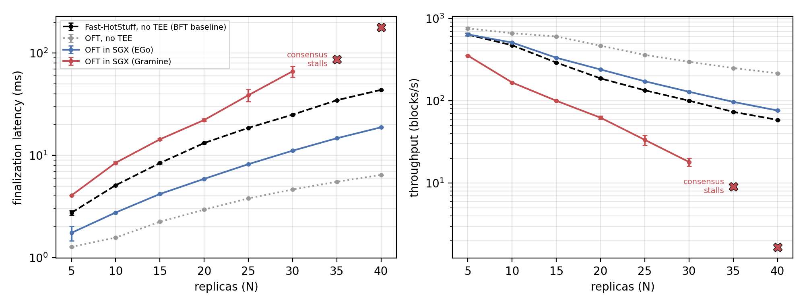
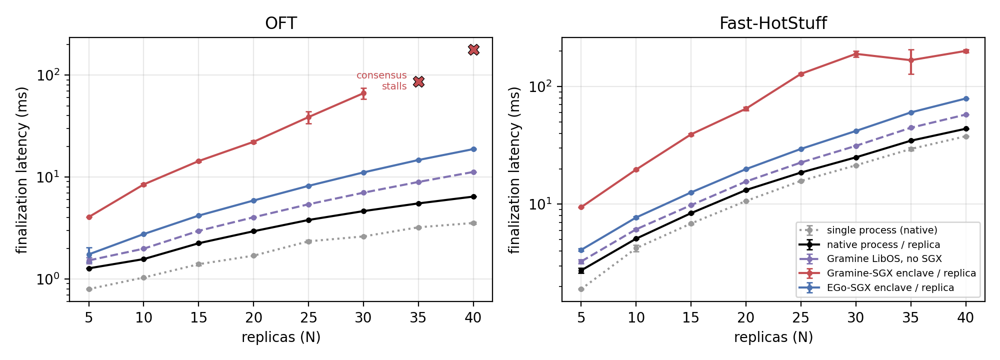
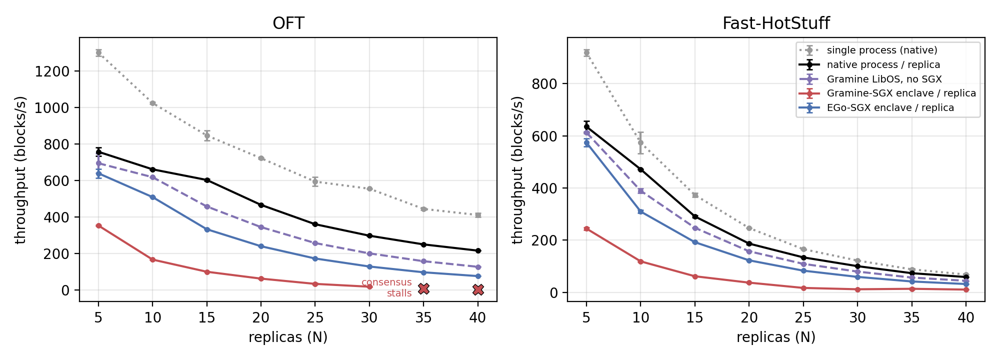
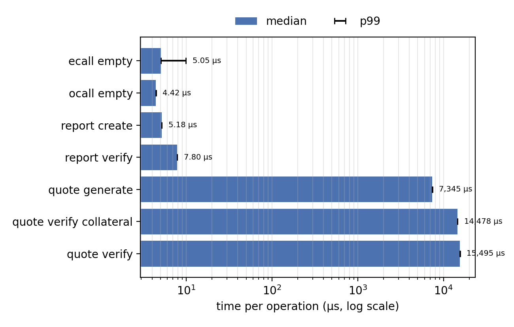

# Experiment 1 on Intel SGX: results

Collected on 2026-10-15/16 with `tee/scripts/run_all.sh` (see `tee/README.md`).

- Platform: Alibaba Cloud `ecs.g7t.4xlarge` (cn-hongkong), Intel Xeon Platinum 8369B (Ice Lake),
  16 vCPUs, 30 GiB RAM, 31 GiB EPC, SGX1 + SGX2 + FLC, Ubuntu 24.04, Linux 6.8 — `platform.json`.
- Runtimes: `inproc`, `native`, `gramine-direct`, `gramine-sgx` (Gramine 1.9), `ego-sgx` (EGo 1.10).
- Protocols: OFT and Fast-HotStuff; N = 5..40; 3 runs each; view timeout 2 s; 240 runs, none failed.

## Preliminary summary

Every replica runs in its own process — and, in the SGX runtimes, its own enclave — on one
host, with the load of `experiments/exp1_finalization.sh` (4 clients × 100 outstanding
commands, batch size 1). Latency is the finalization latency (proposal to commit), averaged
over all replicas and blocks; error bars are the standard deviation over the 3 runs.

**Key findings**

1. **OFT inside SGX is faster than BFT without a TEE at every N.** With EGo, OFT finalizes
   blocks 1.6–2.3× faster than Fast-HotStuff running natively, with equal or higher
   throughput (1.3× at N = 20 and N = 40).
2. **The cost of SGX** (OFT in EGo enclaves vs. OFT in native processes) is +37 % finalization
   latency at N = 5 and +192 % at N = 40, where 40 enclaves share 16 vCPUs.
3. **Enclave transitions cost microseconds, attestation milliseconds:** ECALL 5.1 µs,
   OCALL 4.4 µs, `sgx_create_report` 5.2 µs, `sgx_verify_report` 7.8 µs, DCAP quote 4.1–7.3 ms,
   quote verification 14.5 ms. Attestation happens once per replica, not per block.
4. **Gramine is expensive for Go.** Go issues raw `SYSCALL` instructions, which trap inside an
   enclave; Gramine emulates each one (getppid: 13.9 µs in Gramine-SGX vs. 6.8 µs in EGo and
   0.11 µs natively). OFT in Gramine-SGX is slower than native Fast-HotStuff, and at N ≥ 35 the
   overloaded host stops OFT's consensus (see Notes).
5. **The earlier results hold on the new hardware:** with all replicas in one process (as in
   Figures 4-5), OFT is 2.4× faster than Fast-HotStuff at N = 5 and 10.7× at N = 40.

### OFT in SGX vs. Fast-HotStuff without a TEE



Finalization latency (ms):

| N | Fast-HotStuff, no TEE | OFT, no TEE | OFT in SGX (EGo) | OFT in SGX (Gramine) | OFT-EGo speed-up over Fast-HotStuff |
|---|---|---|---|---|---|
| 5 | 2.75 | 1.27 | 1.75 | 4.06 | 1.57× |
| 10 | 5.10 | 1.57 | 2.76 | 8.46 | 1.85× |
| 20 | 13.2 | 2.94 | 5.89 | 22.2 | 2.24× |
| 30 | 25.0 | 4.64 | 11.1 | 66.5 | 2.25× |
| 40 | 43.7 | 6.43 | 18.8 | consensus stalls | 2.32× |

### Finalization latency and throughput in every runtime





Where the latency goes (OFT, finalization latency):

| Runtime | N = 5 | N = 40 |
|---|---|---|
| all replicas in one process | 0.80 ms | 3.54 ms |
| one native process per replica (baseline) | 1.27 ms | 6.43 ms |
| Gramine LibOS without SGX | 1.52 ms (+20 %) | 11.2 ms (+75 %) |
| EGo enclave per replica | 1.75 ms (+37 %) | 18.8 ms (+192 %) |
| Gramine-SGX enclave per replica | 4.06 ms (+219 %) | consensus stalls |

The full tables are `analysis/exp1_tee.md` and `analysis/exp1_overhead.md`.

### Cost of TEE operations



Median [p99], microseconds unless noted:

| Operation | SGX SDK (C) | Gramine-SGX | EGo | Native |
|---|---|---|---|---|
| Empty ECALL | 5.05 [9.92] | | | |
| Empty OCALL | 4.42 [4.45] | | | |
| ECALL with 4 KiB copied in | 5.62 [11.1] | | | |
| `sgx_create_report` (inside the enclave) | 5.18 [5.21] | 531 via `/dev/attestation` | 7.69 [7.81] | |
| `sgx_verify_report` | 7.80 [7.88] | | 16.8 [17.6] | |
| DCAP quote generation | 7.35 ms | 4.10 ms | 4.19 ms | |
| DCAP quote verification, pre-fetched collateral | 14.5 ms | | | |
| DCAP quote verification, collateral from the QPL cache | 15.5 ms | | 18.3 ms (inside the enclave) | |
| DCAP quote verification, first (collateral fetch) | 572 ms | | | |
| Raw syscall `getppid` | | 13.9 [14.5] | 6.80 [6.88] | 0.11 [0.14] |
| Loopback TCP round trip, 64 B | | 138 [205] | 70.3 [71.3] | 7.40 [11.9] |
| ECDSA P-256 sign | | 78.0 [103] | 40.0 [40.5] | 35.6 [43.9] |
| Enclave start-up (to exit) | | 44.4 s | 4.1 s | 2.8 ms |

EGo's in-enclave clock advances once per millisecond, so EGo operations are timed in batches
of ≥ 50 ms; their percentiles are over batch means. All tables: `analysis/teeops.md`.

### Caveats

- SGX runs inside a VM (Alibaba `g7t`), as with Azure DCsv3.
- All replicas share one host and a loopback network, as in Figures 4-5; this inflates the
  overhead at large N, especially for Gramine.
- The quote verification status of the platform is `CONFIG_AND_SW_HARDENING_NEEDED`: quotes
  verify, but the platform TCB is not at the latest level, which is common for cloud SGX.
- Client latency is recorded but not used: with this load it measures queueing up to the 500 ms
  client timeout.

## Layout

| Path | Content |
|---|---|
| `analysis/` | tables (Markdown, LaTeX, CSV) and figures produced by `tee/scripts/analyze_tee.py` |
| `teeops/` | TEE operation microbenchmarks: SGX SDK (`sgx-sdk.json`), teebench per runtime, DCAP verification of Gramine and EGo quotes, enclave start-up times |
| `teeops-superseded/` | first EGo teebench run, timed per operation with EGo's 1 ms in-enclave clock; replaced by the batched run in `teeops/` |
| `exp1_tee/timeout_2s/<runtime>/<protocol>/N<n>/run<r>/` | per run: `meta.json` (summary, exit code, wall time), `hosts.json`, `done` |
| `exp1_tee_raw_measurements.tar.xz` | the raw `measurements.json` of every worker of every run |
| `exp1_tee_run_logs.tar.xz` | the controller and worker logs (`run.log`) of every run |
| `platform.*`, `run_all.log`, `setup.log`, `build.log` | platform information and campaign logs (enclave MRENCLAVEs are in `build.log`) |

## Reproducing the analysis

```bash
tar -xJf exp1_tee_raw_measurements.tar.xz
python3 ../../../tee/scripts/analyze_tee.py .
```

## Notes

- Gramine-SGX + OFT at N=35 (2 of 3 runs) and N=40 (3 of 3 runs): consensus stopped after
  ~15 s and never recovered (`stalled_runs` in `analysis/exp1_tee.csv`; crosses in the figures).
  The single 16-vCPU host is overloaded by 40 Gramine enclaves (Go system calls trap in
  Gramine-SGX: ~14 µs each), messages arrive after the 2 s view timeout, and OFT's
  timeout-driven view change does not re-synchronize the replicas' views. Fast-HotStuff on the
  same configuration only shows short pauses.
- Quote verification status of the platform: `CONFIG_AND_SW_HARDENING_NEEDED` (signature
  verified; platform TCB not at the latest level).
